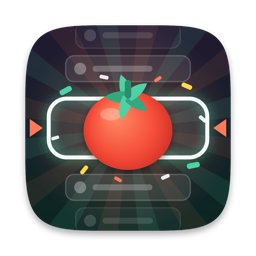
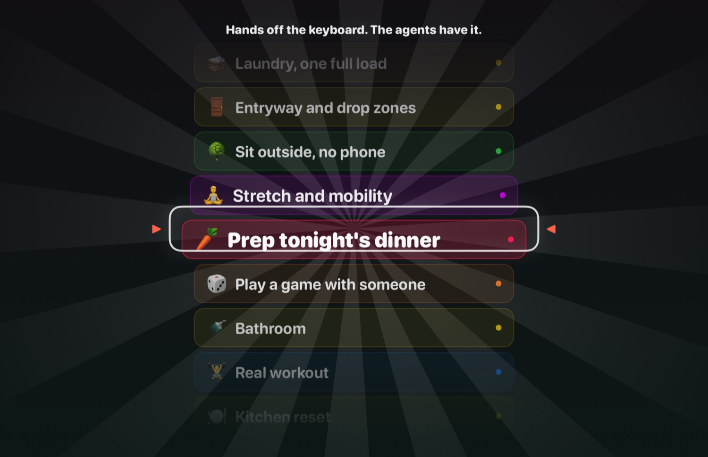
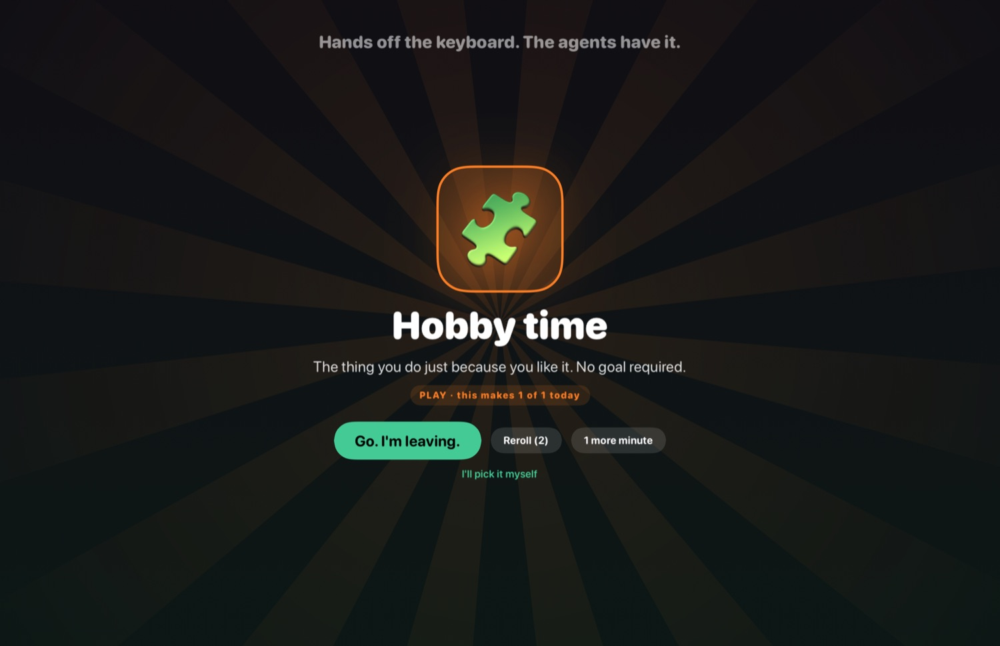
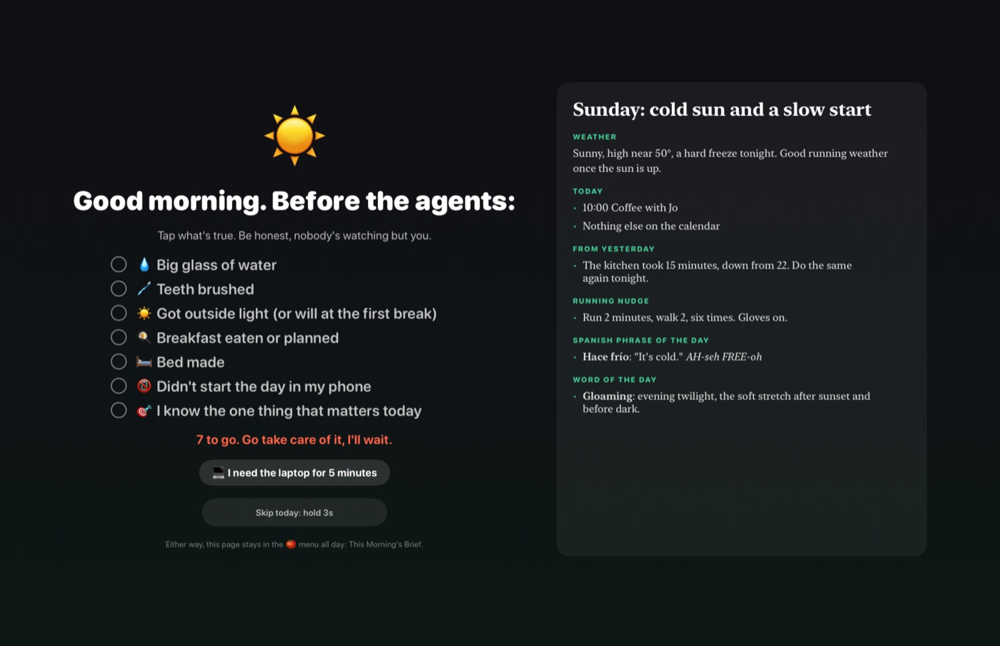
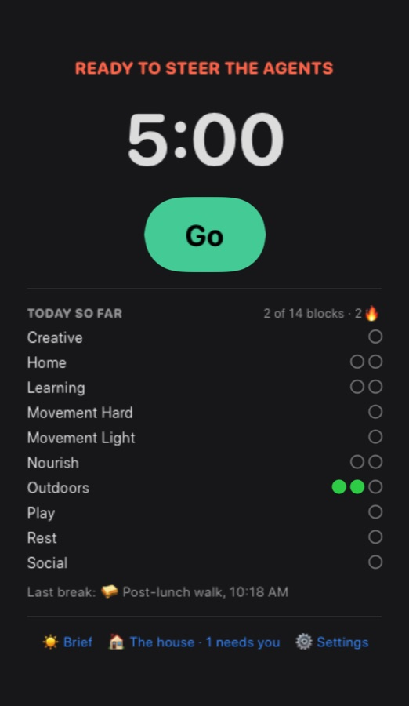

<p align="center"></p>

# SpinBreak

A reversed pomodoro for your Mac. Five minutes at the screen, long enough to point your AI agents somewhere, then twenty-five minutes away from it doing a real thing in your life, picked for you by a spin.

A pomodoro used to be how you made yourself start work. Now that the agents do the typing, watching them has become the thing to avoid everything else with. SpinBreak turns the timer around: short work, long break, and no deciding.




## What it does

- **Spins up your break.** When the work timer ends the screen goes full-screen, a reel of your activities slows down, and one is revealed: walk, read, clean a room, call someone. Reroll if it's wrong (you get two); pick your own if you must.
- **Keeps the day balanced.** Every activity has rules: time windows, daylight, daily aims per category, weekly limits. The spinner leans toward whatever you're behind on today.
- **Opens each workday on a morning list.** A short checklist you tick off before work, next to a morning brief your own AI writes for you.
- **Spreads the cleaning.** Rooms are activities. After one you rate how bad it was, and rough rooms come back sooner. Two people in one home can share a calendar so nobody gets the kitchen the other is already cleaning.
- **Ends the day.** After your workday it locks to "work's done". Weekends are reset days. On either, "Give me a 25" still spins up something to go and do.
- **Dings your wrist.** Break-over alarms go through Reminders, so they reach your iPhone and Apple Watch. Breaks end early before your meetings and show on your calendar.



<p align="center"></p>

## Install

1. Download `SpinBreak-<version>.dmg` from [Releases](../../releases/latest) and drag SpinBreak into Applications.
2. Open it. The app is not notarized yet, so macOS will say it "can't be opened" or "can't verify the developer". Open System Settings › Privacy & Security, scroll down, click "Open Anyway" next to SpinBreak, and confirm. You only do this once.
3. Allow Calendar and Reminders when it asks.

Needs macOS 14 or later. Apple silicon and Intel.

## First run: your own AI finishes the install

SpinBreak opens on Settings › Your AI.

1. Click **Copy setup prompt** and paste it into your AI. Best is one that can run commands on your Mac (Claude Code, Codex, Cursor and the like). A chat AI in a browser works too.
2. Answer its questions: what your morning list should have on it, what you want your breaks filled with, your goals, who you live with, your rooms, your workday, and what you'd like in a morning brief.
3. An AI on your Mac does the rest by itself. It saves your setup, sets up your daily brief, and writes today's as a test. A chat AI gives you a block of JSON to paste back instead.
4. Click **I'm set, let's go**.

Everything it sets up can also be edited by hand in Settings.

## The daily brief

SpinBreak is the scheduler. Each morning after 5 am, as soon as your Mac is awake, it:

1. refreshes `context.json` (today's date, sunrise and sunset, your calendar, yesterday's break log and notes, how your rooms are doing, and the words, phrases and quotes recent briefs already used, so nothing repeats);
2. rewrites `brief-prompt.md`: the instructions for today's brief, with `brief-style.md` (how *you* want it written) and today's data already inside;
3. runs `brief.sh`, a two-line script your AI wrote during setup that runs it on that prompt and prints the brief;
4. saves what it printed, tries again later if there was no brief, and shows what went wrong in Settings › Your AI.

SpinBreak is a timer and a nice face; the thinking is your own agent's. It works out the weather and whatever else you asked for from the web. It gets the web (searching and reading pages) and nothing else: no file access and no shell, with your own settings, plugins and MCP servers left out of the run. A brief is written from calendar titles and web pages that other people wrote, and a writer that can't touch your Mac can't be talked into harming it. For Claude Code, `brief.sh` is:

```sh
#!/bin/sh
exec /full/path/to/claude -p "$(cat brief-prompt.md)" --restricted --tools "WebSearch,WebFetch" --allowedTools "WebSearch" "WebFetch" --strict-mcp-config
```

Add a `brief-style-evening.md` and it writes an evening brief for the lock screen the same way.

All of these live in `~/Library/Application Support/SpinBreak/`.

| File | Who writes it | What it is |
| --- | --- | --- |
| `activities.json` | the app | your activities, categories, rules and morning checklist |
| `setup.json` | your AI | a new setup to import; the app answers in `setup-status.json` |
| `context.json` | the app | today's data for the brief writer |
| `brief-style.md` | you or your AI | how you want the morning brief written |
| `brief-prompt.md` | the app | today's full instructions for the writer, data included |
| `brief.sh` | your AI | runs your AI's command-line tool on `brief-prompt.md` and prints the brief |
| `brief-status.json`, `brief.out`, `brief.log` | the app | how the last run went, what it printed, and its errors |
| `briefing-YYYY-MM-DD.md` | the app | the brief itself |
| `brief.run-now` | anyone | `touch` it to write today's brief right now |

## Privacy

There is no server and no account. Your list, your log and your briefs stay in that folder on your Mac. Your calendar and break notes go only to the AI you chose to write your brief, when it runs, and that run is given the web and nothing else.

## Build it yourself

One folder of Swift files, compiled with the system Swift compiler. No packages, no Xcode project.

```sh
./build.sh                 # SpinBreak.app next to the source, for working on it
./package.sh               # universal app in dist/SpinBreak-<version>.dmg
swift tools/make-icon.swift   # redraw SpinBreak.icns

# the engine's rules, simulated over 300 days
swiftc -O Engine.swift Starter.swift tests/main.swift -o /tmp/enginesim && /tmp/enginesim 300
```

`package.sh` signs with a Developer ID certificate and notarizes when you have them set up (see the comment at its top); otherwise it ad-hoc signs.

Useful while working on it:

```sh
# run against a throwaway folder and settings, without asking for Calendar or touching login items
SpinBreak.app/Contents/MacOS/SpinBreak --sandbox /tmp/spinbreak-test
# draw one screen to a PNG without showing it (see the list in SpinBreak.swift)
SpinBreak.app/Contents/MacOS/SpinBreak --sandbox /tmp/spinbreak-test --snapshot spin /tmp/spin.png
# minutes become seconds
open SpinBreak.app --args --fast
```

| File | What's in it |
| --- | --- |
| `SpinBreak.swift` | the app: state, timers, the full-screen screens, the spin, the start window, the menu |
| `Engine.swift` | how a break gets picked. Foundation only, so it's testable headless |
| `Starter.swift` | the list a new install starts with |
| `Settings.swift` | the Settings window |
| `AISetup.swift` | the setup prompt, and reading what the AI sends back |
| `Brief.swift` | the brief's instructions and its memory of what's been used |
| `Household.swift` | splitting rooms between two people over a shared calendar |

## License

MIT. See [LICENSE](LICENSE).
